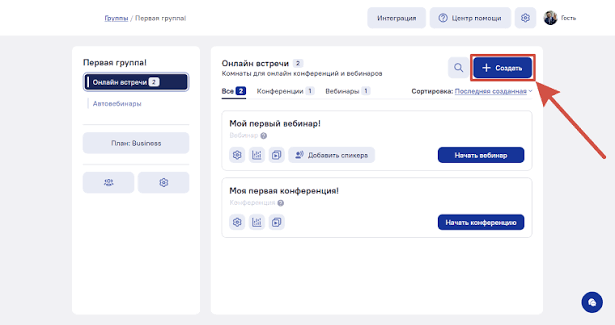

# Создание и настройка комнаты

Организатор может запланировать встречу заранее или запустить мгновенную конференцию для команды.

## Схема экрана настройки комнаты

## Шаги создания встречи

1. Нажмите кнопку **«Новая встреча»** на нижнем меню приложения.
2. Укажите **название конференции**, дату, время начала и длительность.
3. Включите опцию **«Зал ожидания»**, если хотите вручную пускать гостей в комнату.
4. При необходимости задайте **код доступа** и нажмите **«Создать»**.

Скопируйте ссылку на встречу и отправьте её участникам. Если во время эфира понадобится сохранить обсуждение, смотрите раздел [«Запись встреч и архив»](../../features/recordings/README.md).